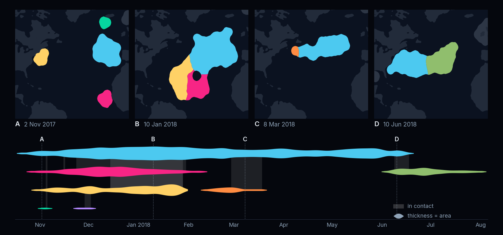
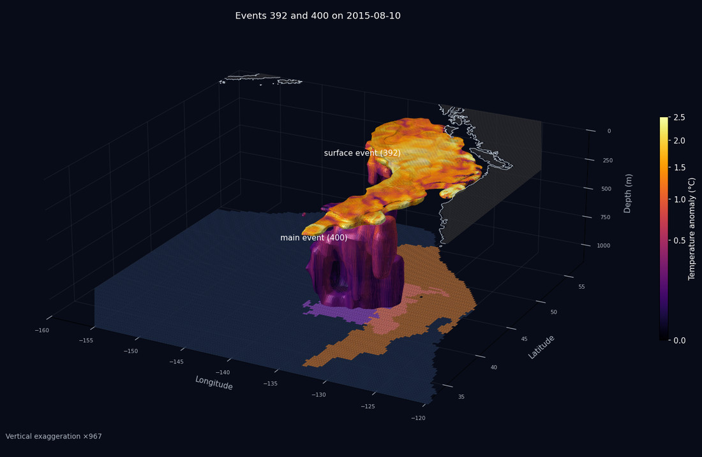

[](https://github.com/wienkers/marEx/actions/workflows/ci.yml?query=branch%3Amain)
[](https://codecov.io/gh/wienkers/marEx)
[](https://badge.fury.io/py/marEx)
[](https://marex.readthedocs.io/en/latest/)
[](https://pepy.tech/projects/marex)
[](https://doi.org/10.5281/zenodo.16922881)

# Weather & Climate Extremes Detection and Tracking

**Efficient & scalable climatologies, anomalies, extreme detection, & event tracking for exascale climate data.**

marEx computes climatologies and anomalies, identifies extremes, and tracks the resulting events through space and time in geospatial time series, in 3-D `(time, lat, lon)` or as physical volumes in 4-D `(time, depth, lat, lon)`. The same calls detect marine and atmospheric heatwaves, cold spells, droughts and subsurface ocean extremes.

**[Full documentation on ReadTheDocs](https://marex.readthedocs.io/)**

---

<!-- pypi-video-thumbnail: media/film_thumbnail.jpg -->
https://github.com/user-attachments/assets/845b6269-972c-4d77-bbdb-eb0d80c84958

<sub>Tracked marine heatwaves (white outlines) and atmospheric heatwaves in 2 m air temperature (cyan) through 2016, over the daily sea surface temperature anomaly. OSTIA SST and ERA5.</sub>

---

## Key Features

- **4-D Spatiotemporal Extreme Event Tracking (v5.1)**: Follows events through `(time, depth, lat, lon)` on lat/lon grids as physical volumes, with each event's volume in m³, depth centroid, and top and bottom depth through time.
- **High Performance**: Process 100+ years of high-resolution daily global data in minutes.
- **Multiple Detection Methods**: Hobday et al. (2016) and its generalisations, with four anomaly baselines and seasonal or constant-in-time percentile thresholds, on either tail, at daily, sub-daily or monthly cadence.
- **Larger-than-Memory**: Intelligent chunking, lazy evaluation and on-disk staging compute the global climatologies, percentile thresholds and event tracks of datasets much larger than memory.
- **Cloud-Native Scaling**: Identical code scales from a laptop to a supercomputer using 1024+ cores.
- **Advanced Event Tracking**: Follows coherent events as they evolve, split and merge, keeping each event's identity and merge history.
- **Universal Grid Support**: Regular lat/lon grids and unstructured meshes (FESOM, ICON, MPAS) through one API, including 4-D detection with depth or level as an extra dimension.

---

## Core Modules

| Step | Returns | Methods |
| --- | --- | --- |
| **1. Anomaly**<br>`marEx.anomaly.compute` | The anomaly field, i.e. the input minus its seasonal climatology (`dat_anomaly`).<br>With `detrend_harmonic`, also standardised anomalies and their rolling standard deviation. `marEx.anomaly.smoothed_rolling_climatology` returns the shifting-baseline climatology itself. | `shifting_baseline`, `fixed_baseline`, `detrend_harmonic`, `detrend_fixed_baseline` |
| **2. Extremes**<br>`marEx.extremes.identify` | A boolean field flagging every extreme cell and time (`extreme_events`).<br>Also: the percentile threshold of every cell, resolved through the year when seasonal (`thresholds`). | `seasonal_percentile` or `global_percentile`, upper or lower tail, exact or histogram percentiles |
| **3. Tracking**<br>`marEx.tracker(...).run()` | An event-ID field labelling each tracked event in space and time (`ID_field`).<br>Also: each event's area and centroid through time, its start and end, and the full merge history.<br>In 4-D: volume, footprint area, depth centroid, and top and bottom depth. | overlap-based merging and splitting, gap filling, area or volume filtering |

`marEx.preprocess_data` runs steps 1 and 2 in one call. Chained together, from daily SST to tracked marine heatwaves:

```python
import xarray as xr
import marEx

# In a script, run this under `if __name__ == "__main__":` (its worker processes re-import the script).
client = marEx.helper.start_local_cluster(n_workers=4, memory_limit="8GB")

sst = xr.open_dataset("sst_data.nc", chunks={"time": 25}).sst

anomalies = marEx.anomaly.compute(sst, method="shifting_baseline")
extremes = marEx.extremes.identify(anomalies, method="seasonal_percentile", threshold_percentile=95)

events = marEx.tracker(
    extremes.extreme_events,
    extremes.mask,
    R_fill=8,
    area_filter_absolute=100,
    allow_merging=True,
).run()

fig, ax, im = (events.ID_field > 0).mean("time").plotX.single_plot(
    marEx.PlotConfig(var_units="Event Frequency", cmap="hot_r", cperc=[0, 96])
)
```

<a href="media/mhw_family.png"></a>

<sub>A family of seven tracked marine heatwaves in the North Atlantic, October 2017 to August 2018 (95th percentile, OSTIA SST). Each colour is one event, and ribbon thickness is its area. Grey bands mark when two events touch. The tracker resolves merges and splits there, and each event keeps its identity.</sub>

---

## 4-D Spatiotemporal Extreme Event Tracking (v5.1)

Declaring depth under `"z"` switches `marEx.tracker` from 3-D to 4-D. Linking, splitting and merging follow the 3-D tracker with volumes in place of areas, so a marine heatwave between 20 and 80 m under a surface that stays cool is one event with a volume and a depth range. 4-D tracking runs on structured lat/lon grids.

```python
events = marEx.tracker(
    extremes,                      # bool (time, depth, lat, lon), Dask-backed
    wet_mask,                      # bool (depth, lat, lon), True where the cell is ocean
    R_fill=8,
    dimensions={"time": "time", "z": "depth", "y": "latitude", "x": "longitude"},
    layer_bounds=ds.depth_bnds,    # (depth, 2) layer interfaces in metres
    grid_resolution=1 / 12,        # or cell_areas=...
    compute_mode="streaming",
    temp_dir="/path/to/scratch/marex_staging",
).run()
```

<a href="media/mhw_4d_blob.jpg"></a>

<sub>Two tracked 4-D marine heatwaves in the northeast Pacific on 10 August 2015 (95th percentile, GLORYS12): a warm slab at the surface and a column reaching the 1150 m limit of the input, coloured by temperature anomaly, with their footprints on the floor. Vertical exaggeration ×967.</sub>

The [guide](https://marex.readthedocs.io/en/latest/guide/tracking.html#tracking-in-4d) covers the vertical geometry, the gap rule and the memory model. The [4-D notebooks](https://marex.readthedocs.io/en/latest/tutorials/4d.html) detect marine heatwaves in 30 years of GLORYS12 on 36 levels to 1150 m at 1/12°, then track the events of the 2013-16 Blob.

---

## Performance

| Stage | Data | Size | Wall-time |
| --- | --- | ---: | ---: |
| Detect | ICON SST, 14.9 M cells, 30 yr daily | **1.3 TB** | 37 min |
| Detect (4-D) | GLORYS12 1/12°, 36 levels, 30 yr daily | **685 GB** | 27 min |
| Detect | Global SST 0.25°, 20 yr 6-hourly | **243 GB** | 166 min |
| Detect | Global SST 0.25°, 40 yr daily | **122 GB** | 61 min |
| Track | Global 0.25°, 20 yr 6-hourly | **91 GB** | 139 min |
| Track | ICON, 14.9 M cells, 3 yr daily | **66 GB** | 70 min |
| Track (4-D) | GLORYS12 1/12°, 36 levels, 4 yr daily | **46 GB** | 75 min |
| Track | Global 0.25°, 10 yr daily | **16 GB** | 27 min |

Sizing guidance is in the [performance guide](https://marex.readthedocs.io/en/latest/guide/performance.html).

---

## Installation

```bash
pip install marEx[full,hpc]
```

For HPC environments and optional dependencies, see the **[Installation Guide](https://marex.readthedocs.io/en/latest/installation.html)**.

---

## Documentation

| Section | What's there |
| --- | --- |
| **[Getting Started](https://marex.readthedocs.io/en/latest/getting_started/index.html)** | Installation and a five-minute quickstart |
| **[Tutorials](https://marex.readthedocs.io/en/latest/tutorials/index.html)** | End-to-end notebooks for gridded, regional and unstructured data, and for 4-D tracking on GLORYS12 |
| **[Applications](https://marex.readthedocs.io/en/latest/applications/index.html)** | Marine and atmospheric heatwaves, wind and precipitation droughts, subsurface ocean extremes and event catalogues |
| **[User Guide](https://marex.readthedocs.io/en/latest/guide/index.html)** | [Anomalies](https://marex.readthedocs.io/en/latest/guide/anomalies.html), [extremes](https://marex.readthedocs.io/en/latest/guide/extremes.html), [dimensions and time](https://marex.readthedocs.io/en/latest/guide/dimensions_and_time.html), tracking, performance, [validation](https://marex.readthedocs.io/en/latest/guide/validation.html) |
| **[What's New](https://marex.readthedocs.io/en/latest/whats_new.html)** | Changes in 5.0 and the migration table for renamed methods and parameters |
| **[Why marEx?](https://marex.readthedocs.io/en/latest/why_marex.html)** | The design choices, with a tracking-comparison video |
| **[API Reference](https://marex.readthedocs.io/en/latest/api/index.html)** | Every public function and class |
| **[Troubleshooting](https://marex.readthedocs.io/en/latest/troubleshooting.html)** | Common issues and solutions |

---

## Development and Validation

I developed the scientific methodology and the implementation of marEx by hand up to and including v4.1 (April 2026), and have since used Claude Code as an aide to help optimise, generalise and test it. Since mid-2026 every change has been checked against reference outputs to round-off precision. The [validation page](https://marex.readthedocs.io/en/latest/guide/validation.html) describes what is tested.

---

## Getting Help

- **[Documentation](https://marex.readthedocs.io/)**: guides, tutorials and API reference
- **[GitHub Issues](https://github.com/wienkers/marEx/issues)**: bug reports and feature requests
- **[GitHub Discussions](https://github.com/wienkers/marEx/discussions)**: questions, ideas and community support

When reporting an issue, include `marEx.__version__`, the Python version and OS, `marEx.print_dependency_status()`, a minimal reproducible example and the full traceback.

---

## Citation

When using marEx in publications, please cite:

- **marEx package**: DOI [10.5281/zenodo.16922881](https://doi.org/10.5281/zenodo.16922881)
- **Hobday et al. (2016)**: "A hierarchical approach to defining marine heatwaves." *Progress in Oceanography* 141, 227-238. DOI [10.1016/j.pocean.2015.12.014](https://doi.org/10.1016/j.pocean.2015.12.014)

---

## License

marEx is licensed under the [GNU Affero General Public License v3.0 or later](LICENSE). You can use, study, modify and share it freely. If you distribute a modified version, or run one as a network service, you must release your changes under the same licence. Keep the [NOTICE](NOTICE) and cite marEx in published work.

The code and documentation are reserved from text and data mining, including AI model training (Art. 4(3) of the EU Directive 2019/790). For other licensing terms, [get in touch](mailto:aaron.wienkers@gmail.com).

---

## Funding

* The [EERIE](https://eerie-project.eu) (European Eddy-Rich ESMs) Project
* The European Union's Horizon Europe research and innovation programme under Grant Agreement No. 101081383
* The Swiss State Secretariat for Education, Research and Innovation (SERI) under contract #22.00366

---

## Contact

For questions, comments, or collaboration opportunities, please contact [Aaron Wienkers](mailto:aaron.wienkers@gmail.com).
